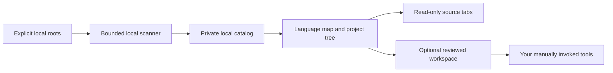

# Code Atlas

**A local, visual project navigator for VS Code.**

Code Atlas turns explicitly selected development folders into a language network and a searchable project list. Browse source in read-only editor tabs, keep projects in their existing locations, and jump to separately reviewed test workspaces when you are ready to work.

This first portable release targets **Linux**, **VS Code 1.100 or newer**, and **Python 3.10 or newer**. It uses the VS Code extension host and Python standard library; it has no runtime npm dependencies and does not need an account or hosted service.

## See the map


*The shipped webview rendered in a browser with an authored fictional catalog. Demonstrates the map, filters and project selection; it is not proof of VS Code integration, source scanning or project tests. [Screenshot provenance](https://github.com/TheOutlandsDev/TheOutlandsDev/blob/main/assets/SHOWCASE.md).*

## Requirements, first try and status

| Requirement | Current preview |
| --- | --- |
| Platform | Linux with `/proc`; other operating systems are not validated here. |
| Editor | VS Code 1.100+; the complete separate-instance recipe was verified on VS Code 1.143.0. |
| Runtime | Python 3.10+ at `/usr/bin/python3`. Node.js 18+ is needed only for development QA. |
| Your input | An existing project directory you own and explicitly choose; there are no default source roots. |
| Status | Linux preview. Source availability and static syntax metadata are separate from build, runtime and project-test results. |

Check the two runtime versions before following the [complete revision 2 setup guide](docs/setup-r2.md):

```sh
code --version
/usr/bin/python3 --version
```

Use the [revision 2 download and checksum steps below](#quick-start--setup-revision-2), then keep all six state-directory options from the setup guide on both install and launch. In that reviewed VS Code instance, choose **OUTLANDS: Open Code Map**, select a language or search for a project, then choose **Browse source files**. The [release checks](docs/release-checks.md) describe the recorded checks and their scope.

## What it does

- Groups discovered source roots by language in an interactive, keyboard-accessible map.
- Searches project names, languages, and local source paths.
- Opens allowed source files through a read-only virtual filesystem.
- Refreshes the local catalog within configured scan budgets and reports limited or unreadable coverage.
- Opens explicitly configured reviewed workspaces for your existing test and development workflows.

Source navigation does not establish project activity, runtime health, successful tests, or complete system coverage. Code Atlas does not copy, relocate, or deploy your projects.



## Quick start — setup revision 2

Use the tested release setup rather than installing into an existing IDE profile:

- [Download the revision 2 setup ZIP](https://github.com/TheOutlandsDev/code-atlas/releases/download/v0.1.0/code-atlas-0.1.0-setup-r2.zip)
- [Download SHA256SUMS-r2](https://github.com/TheOutlandsDev/code-atlas/releases/download/v0.1.0/SHA256SUMS-r2)
- [Follow the complete revision 2 setup guide](docs/setup-r2.md)

From the download folder, verify and extract the bundle:

```sh
sha256sum --check --ignore-missing SHA256SUMS-r2
unzip code-atlas-0.1.0-setup-r2.zip
cd code-atlas-0.1.0-setup-r2
sha256sum --check SHA256SUMS
```

Confirm the ZIP is **OK** before extracting it and all six bundled payload files are **OK** afterward. Follow [the setup guide](docs/setup-r2.md) to configure explicit roots and install/launch with separate user-data, extension, **shared-data** and agent/plugin directories. The complete CLI recipe was verified on **VS Code 1.143.0**; the extension's minimum remains 1.100. Stop if another build warns about unknown options or rejects them.

The default private configuration home is `~/.code-atlas`. The setup tool refuses broad roots or an existing configuration. Set a new `CODE_ATLAS_HOME` outside your sources for a separate experiment and keep the same complete state-directory options on install and launch. Configuration and environment details are in [configuration](docs/configuration.md).

Keep workspace trust enabled and inspect the workspace and extension before trusting them. An empty dashboard can already be trusted; this alone does not mean trust is disabled. In VS Code, choose **OUTLANDS: Open Code Map** from the Command Palette or use the **Code Atlas** Explorer view. **Refresh map** requests another bounded scan.

## Find a project

1. Choose a language or enter a project name in **Find code**.
2. Select a project node or an item in the source-root list.
3. Choose **Browse source files**, expand folders, and open a file.
4. To edit or test, open the original project separately or use an explicitly configured reviewed workspace.

The read-only source view helps keep browsing separate from editing. It does not change filesystem permissions or restrict what other extensions and processes can do. See [security boundaries](SECURITY.md).

## Testing and IDE tooling

Code Atlas can open a workspace you have reviewed and configured. That workspace can provide your own VS Code Testing integrations, tasks, debugger configuration, linters, and type checkers. The portable release does not install project dependencies or execute commands discovered in source files.

The private deployment that inspired this project has additional isolated test runners. Those runners, their source inventories, and their run receipts are excluded from this repository. The portable release does **not** ship a universal aggregate test runner; its aggregate action is unavailable. Repository QA verifies the public extension and synthetic scanner fixtures, separately from any downstream project's tests.

Read [reviewed workspace navigation](docs/reviewed-workspaces.md) before enabling those shortcuts.

## Develop and verify

Use Node.js 18 or newer for JavaScript QA, alongside Python 3.10 or newer:

```sh
python3 -I -B tools/check.py
python3 -I -B tools/package.py
```

The check command runs the Python, extension-core, and map DOM suites, plus offline release/documentation checks and a temporary synthetic setup/scan workflow. That workflow exercises the real setup helper and scanner with Python, Rust and TypeScript fixtures, checks refresh after a Go project is created and deleted, and verifies original sample files stay unchanged. It runs no project code or project tests.

The [release checks](docs/release-checks.md) also verify the pinned public ZIP and checksums in GitHub Actions, then repeat the setup/scan workflow using the helper from that ZIP and scanner from the released VSIX. They do not start VS Code or inspect private roots. A passing suite is not a claim that arbitrary projects build, that every filesystem race is prevented, or that an installed VS Code window has completed a manual acceptance check.

Packaging is offline and uses an explicit runtime allowlist. It refuses to overwrite an existing VSIX; preserve an earlier artifact or use a clean checkout before packaging again. Building a VSIX does not publish it to the VS Code Marketplace. A development build from a changed checkout can have different bytes from the pinned published installer; release checks validate the published artifact separately.

- [Current revision 2 setup](docs/setup-r2.md)
- [Automated release checks](docs/release-checks.md)
- [Configuration and limits](docs/configuration.md)
- [Architecture and data flow](docs/architecture.md)
- [Reviewed workspaces](docs/reviewed-workspaces.md)
- [Troubleshooting](docs/troubleshooting.md)
- [Contributing](CONTRIBUTING.md)
- [Changelog](CHANGELOG.md)

## License

Code Atlas is available under the [MIT License](LICENSE). Copyright 2026 TheOutlandsDev.
