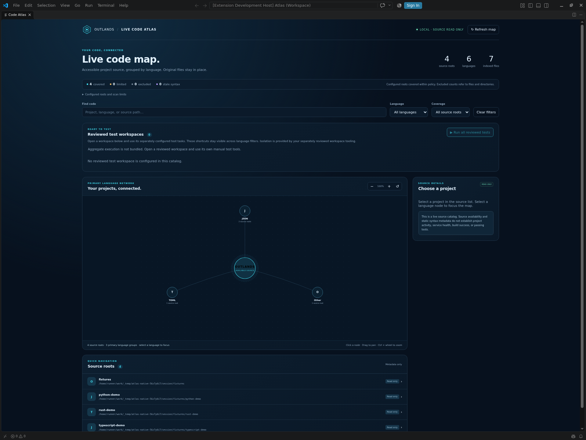
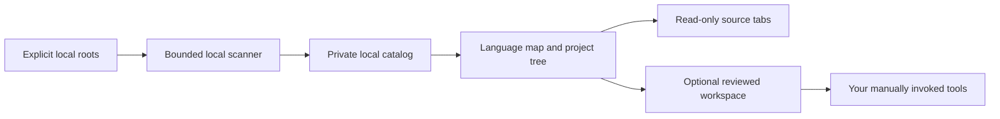

# Code Atlas

**A local, visual project navigator for VS Code.**

Code Atlas turns explicitly selected development folders into a language network and a searchable project list. Browse source in read-only editor tabs, keep projects in their existing locations, and jump to separately reviewed test workspaces when you are ready to work.

Code Atlas targets **Linux**, **VS Code 1.100 or newer**, and **Python 3.10 or newer**. It uses the VS Code extension host and Python standard library; it has no runtime npm dependencies and does not need an account or hosted service.

## Published version 0.1.3

Code Atlas now recognizes mixed-case extensions and gives exact manifest names and explicitly configured suffixes priority. Source line counts and static checks stay tied to the file observed during discovery. Files that change during a scan stay pending until the next scan, and the map marks incomplete counts as partial. [Release notes and downloads](https://github.com/TheOutlandsDev/code-atlas/releases/tag/v0.1.3) · [Line counts and freshness](docs/line-counts.md)

For a new setup, use the revision 2 configuration helper. For an upgrade, reuse your existing Code Atlas configuration and the same six VS Code state directories. Both paths install the same checksum-verified 0.1.3 VSIX. [Install and upgrade instructions](#install-or-upgrade-to-013)

## See the map

[](https://github.com/TheOutlandsDev/code-atlas/actions/workflows/native-acceptance.yml)

**The pinned 0.1.0 setup release has reproducible native Linux checks.** VS Code 1.143.0 passed 38 first-launch, 39 restart and 12 Restricted Mode control assertions using generated source files. [Native test results and upgrade workflow](docs/native-acceptance.md)



*Actual installed release on a CI virtual display. The real scanner indexed three generated projects plus their selected parent. Native API checks and rendered captures passed; manual desktop search, filters and keyboard acceptance remain pending.*

**[Live demo — explore Code Atlas in your browser](https://connor-oshea-outlands.thatrobotguy.chatgpt.site/demos/code-atlas/)**

No installation is needed. Filter languages, search six fictional projects,
select a source root, and pan or zoom the map. This is a browser preview of the
public webview with an authored catalog; it does not run VS Code, scan folders,
read source files or execute project tests. Use the setup guide below for the
actual Linux/VS Code extension.


## Requirements, first try and status

| Requirement | Current preview |
| --- | --- |
| Platform | Linux with `/proc`; other operating systems are not validated here. |
| Editor | VS Code 1.100+; the complete separate-instance recipe was verified on VS Code 1.143.0. |
| Runtime | Python 3.10+ at `/usr/bin/python3`. Node.js 18+ is needed only for development QA. |
| Your input | An existing project directory you own and explicitly choose; there are no default source roots. |
| Status | Linux preview. Source availability and static syntax metadata are separate from build, runtime and project-test results. |

Check both runtime versions before configuring the dedicated Code Atlas instance.

```sh
code --version
/usr/bin/python3 --version
```

Keep all six state-directory options when installing and launching the dedicated instance. In that instance, choose **OUTLANDS: Open Code Map**, select a language or search for a project, then choose **Browse source files**. [Install and upgrade instructions](#install-or-upgrade-to-013) · [Release checks](docs/release-checks.md)

## What it does

- Groups discovered source roots by language in an interactive, keyboard-accessible map.
- Searches project names, languages, and local source paths.
- Opens allowed source files through a read-only virtual filesystem.
- Refreshes the local catalog within configured scan budgets and reports limited or unreadable coverage.
- Counts physical lines in eligible source files with a bounded read budget, marking partial totals clearly. See [line count semantics](docs/line-counts.md).
- Opens explicitly configured reviewed workspaces for your existing test and development workflows.

Source navigation does not establish project activity, runtime health, successful tests, or complete system coverage. Code Atlas does not copy, relocate, or deploy your projects.



## Install or upgrade to 0.1.3

For an existing installation, close its dedicated Code Atlas window and use the same `CODE_ATLAS_HOME` and all six profile directories you used before. Export that `CODE_ATLAS_HOME` in your terminal, then go directly to [installing the published VSIX](#install-the-published-vsix).

### First-time configuration with setup revision 2

- [Download the revision 2 setup ZIP](https://github.com/TheOutlandsDev/code-atlas/releases/download/v0.1.0/code-atlas-0.1.0-setup-r2.zip)
- [Download SHA256SUMS-r2](https://github.com/TheOutlandsDev/code-atlas/releases/download/v0.1.0/SHA256SUMS-r2)
- [Read the pinned revision 2 setup guide](docs/setup-r2.md)

From the download directory, verify the ZIP before extracting it. Check that the ZIP and all six payload files report **OK**.

```sh
sha256sum --check --ignore-missing SHA256SUMS-r2 &&
  unzip code-atlas-0.1.0-setup-r2.zip &&
  cd code-atlas-0.1.0-setup-r2 &&
  sha256sum --check SHA256SUMS
```

In the extracted directory, choose a new configuration home outside your sources. Replace the example source path with an existing project directory you own. Repeat `--root` for additional roots.

```sh
export CODE_ATLAS_HOME="$HOME/.code-atlas"
/usr/bin/python3 -I -B tools/configure.py --root "/absolute/path/to/your/projects"
```

The setup helper refuses broad roots and existing configuration directories. Use the upgrade path when you already have a reviewed configuration. [Configuration and limits](docs/configuration.md)

### Install the published VSIX

Download `code-atlas-0.1.3.vsix` and `SHA256SUMS-0.1.3` into the same folder. In the terminal with your chosen `CODE_ATLAS_HOME` exported, change to that download folder. [VSIX](https://github.com/TheOutlandsDev/code-atlas/releases/download/v0.1.3/code-atlas-0.1.3.vsix) · [SHA256SUMS-0.1.3](https://github.com/TheOutlandsDev/code-atlas/releases/download/v0.1.3/SHA256SUMS-0.1.3)

The helper below passes the same six directories on installation, version readback and launch. It uses the revision 2 directory names. If you customized your profile paths, use the same exact paths as your previous installation. These options were verified with VS Code 1.143.0. If another build rejects an option or reports it unknown, check that build's support before proceeding.

```sh
atlas_code() {
  command code --user-data-dir "$CODE_ATLAS_HOME/vscode-user" \
    --extensions-dir "$CODE_ATLAS_HOME/vscode-extensions" \
    --shared-data-dir "$CODE_ATLAS_HOME/vscode-shared" \
    --agent-plugins-dir "$CODE_ATLAS_HOME/agent-plugins" \
    --agents-user-data-dir "$CODE_ATLAS_HOME/agents-user" \
    --agents-extensions-dir "$CODE_ATLAS_HOME/agents-extensions" \
    "$@"
}

test -n "${CODE_ATLAS_HOME:-}" &&
  test -f "$CODE_ATLAS_HOME/Atlas.code-workspace" &&
  sha256sum --check SHA256SUMS-0.1.3 &&
  atlas_code --install-extension "$PWD/code-atlas-0.1.3.vsix" &&
  atlas_code --list-extensions --show-versions
```

After the checksum reports **OK** and the extension list shows `TheOutlandsDev.code-atlas@0.1.3`, launch from that same terminal.

```sh
atlas_code --sync off --new-window "$CODE_ATLAS_HOME/Atlas.code-workspace"
```

Keep workspace trust enabled. Inspect the workspace and extension, then trust only the workspace and folders you reviewed. Choose **OUTLANDS: Open Code Map** from the Command Palette or use the **Code Atlas** Explorer view. **Refresh map** requests a new bounded scan.

## Find a project

1. Choose a language or enter a project name in **Find code**.
2. Select a project node or an item in the source-root list.
3. Choose **Browse source files**, expand folders, and open a file.
4. To edit or test, open the original project separately or use an explicitly configured reviewed workspace.

The read-only source view helps keep browsing separate from editing. It does not change filesystem permissions or restrict what other extensions and processes can do. See [security boundaries](SECURITY.md).

## Testing and IDE tooling

Code Atlas can open a workspace you have reviewed and configured. That workspace can provide your own VS Code Testing integrations, tasks, debugger configuration, linters, and type checkers. The portable release does not install project dependencies or execute commands discovered in source files.

The private deployment that inspired this project has additional isolated test runners. Those runners, their source inventories, and their run receipts are excluded from this repository. The portable release does **not** ship a universal aggregate test runner; its aggregate action is unavailable. Repository QA verifies the public extension and synthetic scanner fixtures, separately from any downstream project's tests.

Read [reviewed workspace navigation](docs/reviewed-workspaces.md) before enabling those shortcuts.

## Develop and verify

Use Node.js 18 or newer for JavaScript QA, alongside Python 3.10 or newer:

```sh
python3 -I -B tools/check.py
python3 -I -B tools/package.py
```

The check command runs the Python, extension-core, and map DOM suites, plus offline release/documentation checks and a temporary synthetic setup/scan workflow. That workflow exercises the real setup helper and scanner with Python, Rust and TypeScript fixtures, checks refresh after a Go project is created and deleted, and verifies original sample files stay unchanged. It runs no project code or project tests.

Native acceptance covers the pinned 0.1.0 setup release, the VSIX built from a pull request, and the published 0.1.2 to 0.1.3 upgrade. Each check uses generated source files in a dedicated Linux VS Code profile. [Native acceptance and workflow instructions](docs/native-acceptance.md)

The [release checks](docs/release-checks.md) also verify the pinned public ZIP and checksums in GitHub Actions, then repeat the setup/scan workflow using the helper from that ZIP and scanner from the released VSIX. They do not start VS Code or inspect private roots. A passing suite is not a claim that arbitrary projects build, that every filesystem race is prevented, or that an installed VS Code window has completed a manual acceptance check.

Packaging is offline and uses an explicit runtime allowlist. It refuses to overwrite an existing VSIX; preserve an earlier artifact or use a clean checkout before packaging again. Building a VSIX does not publish it to the VS Code Marketplace. A development build from a changed checkout can have different bytes from the pinned published installer; release checks validate the published artifact separately.

- [Install or upgrade to 0.1.3](#install-or-upgrade-to-013)
- [Pinned revision 2 setup guide](docs/setup-r2.md)
- [Native Linux acceptance and screenshots](https://github.com/TheOutlandsDev/code-atlas/blob/main/docs/native-acceptance.md)
- [Automated release checks](docs/release-checks.md)
- [Configuration and limits](docs/configuration.md)
- [Architecture and data flow](docs/architecture.md)
- [Reviewed workspaces](docs/reviewed-workspaces.md)
- [Troubleshooting](docs/troubleshooting.md)
- [Contributing](CONTRIBUTING.md)
- [Changelog](CHANGELOG.md)

## License

Code Atlas is available under the [MIT License](LICENSE). Copyright 2026 TheOutlandsDev.
