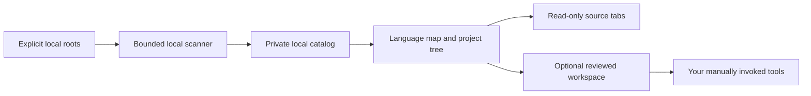

# Code Atlas

**A local, visual project navigator for VS Code.**

Code Atlas turns explicitly selected development folders into a language network and a searchable project list. Browse source in read-only editor tabs, keep projects in their existing locations, and jump to separately reviewed test workspaces when you are ready to work.

This first portable release targets **Linux**, **VS Code 1.100 or newer**, and **Python 3.10 or newer**. It uses the VS Code extension host and Python standard library; it has no runtime npm dependencies and does not need an account or hosted service.

## What it does

- Groups discovered source roots by language in an interactive, keyboard-accessible map.
- Searches project names, languages, and local source paths.
- Opens allowed source files through a read-only virtual filesystem.
- Refreshes the local catalog within configured scan budgets and reports limited or unreadable coverage.
- Opens explicitly configured reviewed workspaces for your existing test and development workflows.

Source navigation does not establish project activity, runtime health, successful tests, or complete system coverage. Code Atlas does not copy, relocate, or deploy your projects.



## Quick start

Clone or download this repository into a development directory. From its root:

```sh
python3 -I -B tools/configure.py --root /absolute/path/to/your/projects
python3 -I -B tools/package.py
code --install-extension dist/code-atlas-0.1.0.vsix
code --new-window "$HOME/.code-atlas/Atlas.code-workspace"
```

Replace the example root with a folder you own and want to index. Repeat `--root` to add another root during initial configuration. Configuration is explicit: there are no default source roots, and the setup tool refuses to overwrite an existing configuration.

The default private configuration directory is `~/.code-atlas`. To use another location, set `CODE_ATLAS_HOME` to an absolute, canonical directory before configuring and launch VS Code with the same environment. See [configuration](docs/configuration.md) for the complete procedure.

Review the workspace and trust it only after inspecting its configuration and the extension source. In VS Code, choose **OUTLANDS: Open Code Map** from the Command Palette or use the **Code Atlas** Explorer view. Use **Refresh map** after changing configuration or when you want a new local scan.

## Find a project

1. Choose a language or enter a project name in **Find code**.
2. Select a project node or an item in the source-root list.
3. Choose **Browse source files**, expand folders, and open a file.
4. To edit or test, open the original project separately or use an explicitly configured reviewed workspace.

The read-only source view helps keep browsing separate from editing. It does not change filesystem permissions or restrict what other extensions and processes can do. See [security boundaries](SECURITY.md).

## Testing and IDE tooling

Code Atlas can open a workspace you have reviewed and configured. That workspace can provide your own VS Code Testing integrations, tasks, debugger configuration, linters, and type checkers. The portable release does not install project dependencies or execute commands discovered in source files.

The private deployment that inspired this project has additional isolated test runners. Those runners, their source inventories, and their run receipts are excluded from this repository. The portable release does **not** ship a universal aggregate test runner; its aggregate action is unavailable. Repository QA verifies the public extension and synthetic scanner fixtures, separately from any downstream project's tests.

Read [reviewed workspace navigation](docs/reviewed-workspaces.md) before enabling those shortcuts.

## Develop and verify

Use Node.js 18 or newer for JavaScript QA, alongside Python 3.10 or newer:

```sh
python3 -I -B tools/check.py
python3 -I -B tools/package.py
```

The check command runs the Python, extension-core, and map DOM suites. They use synthetic fixtures and local mocks. A passing suite is not a claim that arbitrary projects build, that every filesystem race is prevented, or that an installed VS Code window has completed a manual acceptance check.

Packaging is offline and uses an explicit runtime allowlist. It refuses to overwrite an existing VSIX; preserve an earlier artifact or use a clean checkout before packaging again. Building a VSIX does not publish it to the VS Code Marketplace.

- [Configuration and limits](docs/configuration.md)
- [Architecture and data flow](docs/architecture.md)
- [Reviewed workspaces](docs/reviewed-workspaces.md)
- [Troubleshooting](docs/troubleshooting.md)
- [Contributing](CONTRIBUTING.md)
- [Changelog](CHANGELOG.md)

## License

Code Atlas is available under the [MIT License](LICENSE). Copyright 2026 TheOutlandsDev.
