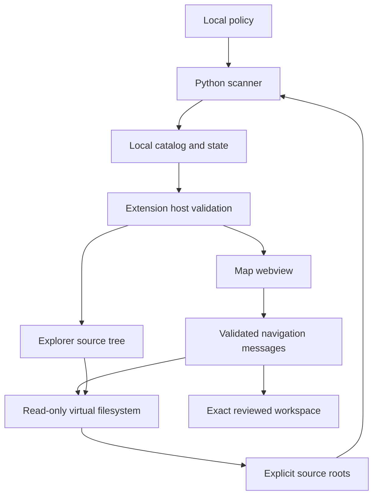

# Architecture

Code Atlas has three local components: a scanner, a VS Code extension, and a webview. It stores discovery state separately from project source.

## Discovery

The Python scanner traverses only configured roots, excludes configured names and paths, and obeys directory, file, project, and time budgets. It does not infer that every discovered root is active. Missing or unreadable folders and exhausted budgets remain visible as incomplete coverage.

Discovery and metadata validation do not import a project's modules, execute its scripts, run its package manager, or start services. Syntax and language metadata are separate from build, lint, type-check, and test results.

## Extension host

The extension loads local configuration, validates the catalog, exposes the Explorer tree, and controls the map's navigation messages. Its filesystem provider authorizes reads against the current policy and rejects writes, renames, directory creation, and deletes through the virtual scheme.

Canonical path and descriptor checks are designed to reject symlink redirection and unexpected file replacement. They are defense-in-depth checks within a process that still has the user's permissions. They are not a claim of formal filesystem isolation.

## Webview

The webview renders language and project nodes from validated catalog metadata. It sends constrained navigation requests to the extension host. Source names and paths are data, not executable commands or trusted markup. The extension supplies a Content Security Policy and local resources.

## Reviewed workspace navigation

An optional policy entry maps an authorized source root to an exact local workspace. The extension can open that workspace after an explicit user action. It does not inspect source manifests for commands or launch project tests during scans.

Any tasks, test adapters, debugger sessions, dependency installation, or isolation in that workspace belong to that separately reviewed workflow. The public release does not include the private deployment's aggregate runner or its project-specific adapters.

## Public verification

Python checks exercise scanner and configuration behavior using temporary synthetic folders. JavaScript checks use local mocks for extension host and map behavior. Packaging produces a VSIX from the public runtime allowlist. A package build is not a Marketplace publication or a manual VS Code acceptance result.

See [configuration](configuration.md) for local state and limits, and [security](../SECURITY.md) before widening roots or adding execution features.
