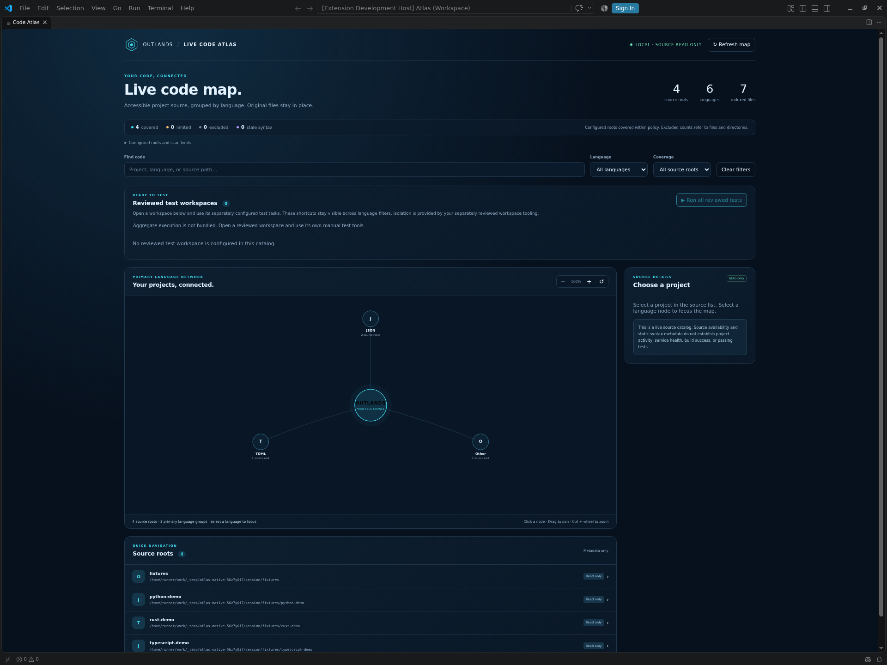
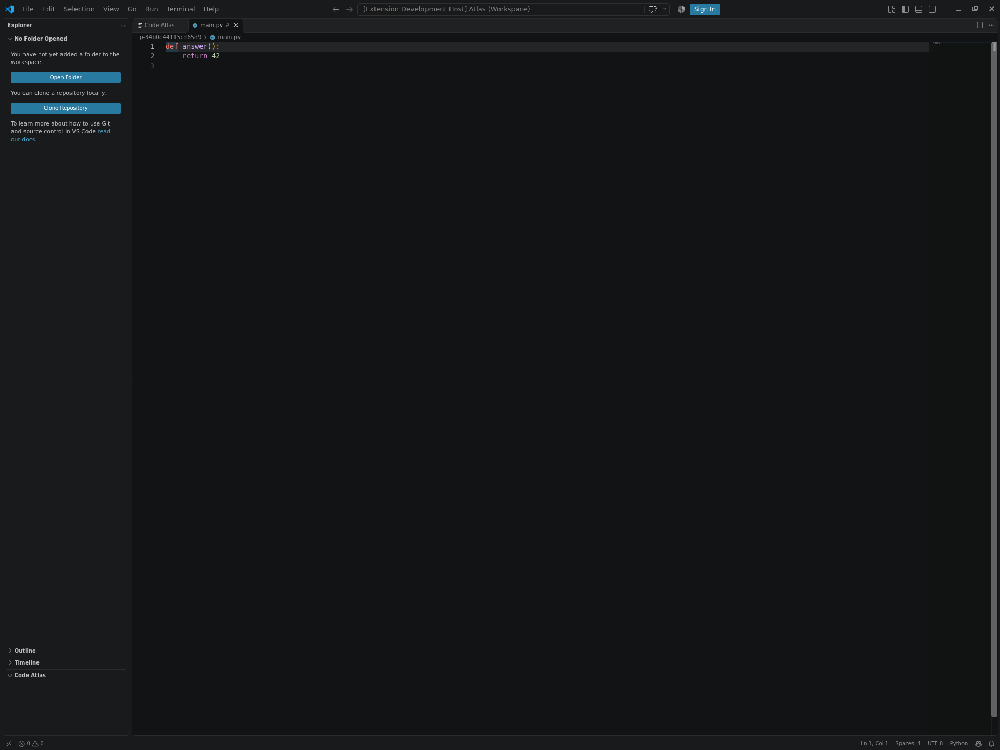

# Native published-extension acceptance

The **Native published VSIX acceptance** workflow installs the released Code Atlas 0.1.0 VSIX into an isolated Linux VS Code 1.143.0 window. A test-only development helper calls the real editor APIs; Code Atlas itself is loaded from the installed release, not from the source checkout.

## Recorded result

[The recorded native run passed](https://github.com/TheOutlandsDev/code-atlas/actions/runs/40439309883) on GitHub-hosted Ubuntu 22.04 x64 with VS Code 1.143.0 and the unchanged released VSIX. It passed **38 first-launch assertions, 39 restart assertions and 12 Restricted Mode control assertions**. The [frozen reports and hashes](evidence/PROVENANCE.json) identify the exact test commit and captures.



*Actual native CI capture, with three generated projects and their selected parent: four roots, six languages, seven indexed files. No private project was scanned. The screenshot is unchanged; its temporary paths belong only to the fictional CI fixture.*

### A short walkthrough

1. **Select explicit folders.** The published setup helper creates a new policy for the generated source parent. The installed extension scans Python, Rust and TypeScript fixtures without executing their code.
2. **Open the map and browse source.** Native commands create the actual webview, select the Python root and open `main.py` through the read-only filesystem. Write, delete, rename and traversal attempts are refused.
3. **Close and reopen.** The second editor process retains the isolated setting and catalog identities and repeats the checks. Controlled file/root moves invalidate stale URIs; fixture contents are restored to their original SHA-256 hashes.



*API-driven native source navigation. The lock icon and generated function are visible in the real editor. This does not establish manual search, filter or keyboard acceptance.*

## Reproduce the check

Use Linux x64 with an X display, Python 3.12 for this test driver, `/usr/bin/python3` 3.10+ for the released scanner, and the virtual-display libraries listed in [the workflow](../.github/workflows/native-acceptance.yml). From a clean checkout:

```sh
xvfb-run -a -s "-screen 0 1920x1440x24" python3 -I -B tools/check_native.py
```

The CI workflow also passes `--ci-window-manager` to start and stop its own Openbox instance inside Xvfb so the maximized window fills the capture. This option refuses execution outside GitHub CI; it does not configure a developer desktop.

The driver downloads the four pinned revision 2 release assets and Microsoft's exact Linux editor archive. It checks sizes, SHA-256 digests, ZIP contents and the editor package version before execution. The [IDE lock](../tests/native/ide-lock.json) identifies the version-specific Microsoft download. It creates a private temporary HOME, seven original fictional source files, a new Code Atlas configuration and all six separate editor state directories. It does not inspect existing projects or inherit developer credentials.

For an already downloaded, matching Microsoft archive, add `--ide-archive /absolute/path/to/code-1.143.0-linux-x64.tar.gz`. `--work-dir` and `--artifacts-dir` must name new absolute directories. Work directories are retained for diagnosis; the driver does not remove an existing directory. On another operating system, `--verify-inputs` checks the pinned downloads only and reports that native execution was not run.

## What the native check exercises

| Phase | Required behavior |
| --- | --- |
| Restricted Mode before trust | The generated workspace is untrusted, Workspace Trust is enabled and the published extension stays inactive. |
| First trusted launch | The installed VSIX activates; the scanner returns exactly the fixture parent and Python, Rust and TypeScript projects; the real webview and read-only source document open. |
| File boundaries and refresh | The native filesystem denies writes, deletion, rename and traversal. Controlled renames, moved roots and deleted files invalidate stale views. Only generated fixtures are changed and their original byte hashes are restored. |
| Restart | The isolated editor setting and catalog identities persist. Scanning and the same read-only checks pass again. |
| Unrelated workspace | A separate generated workspace remains untrusted in the same profile, with Code Atlas inactive. |

The editor is launched as a normal isolated development window. VS Code's `--extensionTestsPath` mode uses in-memory storage, which cannot establish restart persistence. The test helper writes a bounded result and closes its own window; the Python driver requires every phase report to pass even if the editor exits with code zero.

## Workspace Trust fixture

Trust stays enabled. After the first Restricted Mode check, the stopped disposable profile receives one trust entry for the **exact generated Atlas.code-workspace file**. No parent directory, HOME or source checkout is trusted. This pinned-version test setup uses the reviewed VS Code 1.143.0 shared-storage format; it refuses an unexpected database schema or pre-existing trusted locations. The final unrelated-workspace check verifies that the grant did not expand to a parent.

This is CI fixture provisioning, not the user setup procedure. When trying Code Atlas yourself, inspect the extension and selected roots, then use VS Code's normal Workspace Trust interface. Keep the complete [revision 2 install and launch options](setup-r2.md).

Implementation references: Microsoft's [trust state and workspace-URI handling](https://github.com/microsoft/vscode/blob/1.143.0/src/vs/workbench/services/workspaces/common/workspaceTrust.ts), [shared storage location and in-memory extension-test mode](https://github.com/microsoft/vscode/blob/1.143.0/src/vs/platform/storage/electron-main/storageMainService.ts), and [storage filename](https://github.com/microsoft/vscode/blob/1.143.0/src/vs/platform/storage/electron-main/storageMain.ts).

## Evidence and limits

The workflow uploads only bounded JSON reports, captures of its private virtual display and sanitized diagnostics. It does not upload raw editor logs, private source, environment dumps or credentials. Run artifacts expire after 14 days; selected reviewed results and images can be retained with the repository documentation.

These are native API integration checks and real CI-rendered captures. Manual clicking, typing into search, language and coverage filters, keyboard navigation, zoom/pan and visual focus acceptance in an installed Linux desktop remain separate checks. The browser demo's fictional catalog and DOM tests demonstrate those interface controls in their own environment.

No downstream project is built or executed. Private projects, deployment, Windows/macOS, other editor builds and real developer handoffs are outside this run's scope. The published VSIX and revision 2 installer remain unchanged.
